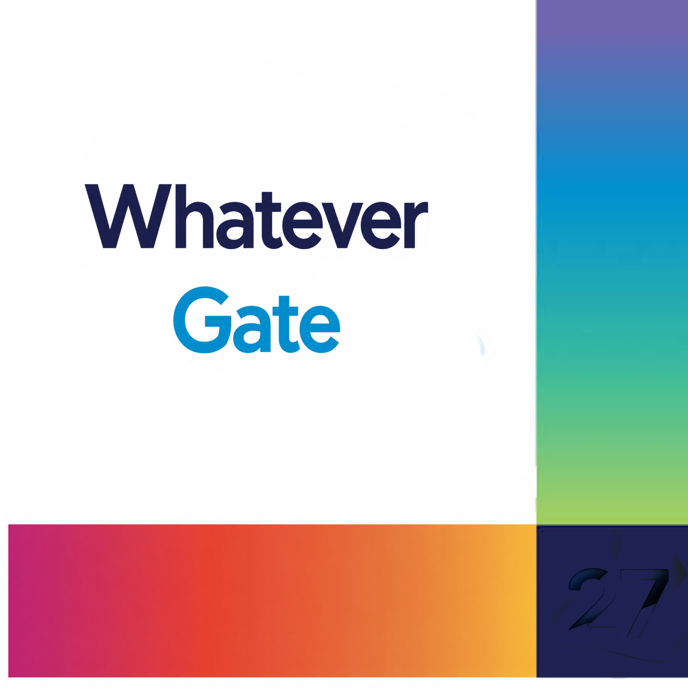

</img>

> [!NOTE]
> This project is looking for testers, any help will be thanked.

WhateverXe is a Lilu plugin, derived from WhateverGreen, that adapts Apple graphics drivers for selected Intel Xe-LP integrated GPUs.

WhateverGate is the fork of WhateverXe designed to get Metal 2 on Golden Gate.

## Compatibility

| macOS | Required version |
| --- | --- |
| Golden Gate | 27.2 (Nullmoth Liberator, Intel) |

Golden Gate uses manual staging of the matching Graphics components.

### Tested on hardware

- Raptor Lake-U: 48-EU configurations.

See [tested features and known issues](#tested-features-and-known-issues) for OS coverage and display configurations. PCI IDs are listed in [device selection](docs/device-selection.md).

### Expected to work, not yet tested on hardware

- Tiger Lake-U: 48- and 80-EU configurations.
- Alder Lake-N: 16- and 24-EU configurations.
- Twin Lake: 32-EU configurations.
- Alder Lake-H: 96-EU configurations, including single-channel operation.
- Alder Lake-S: UHD Graphics 770.
- Other supported Tiger Lake-U/H35 configurations, including 96 EU, and Tiger Lake-H45.
- Other supported Alder Lake-N / Twin Lake configurations.
- Other supported Alder Lake-H/P/U and Raptor Lake-H/P/U configurations.
- Other supported Alder Lake-S/HX and Raptor Lake-S/HX configurations.
- Internal eDP on Alder Lake-N / Twin Lake and Alder Lake-H/P/U / Raptor Lake-H/P/U is implemented but has not been tested on hardware. Brightness supports PCH PWM and standard VESA AUX; panel-specific OLED/Intel HDR brightness remains unqualified.

### Further implementation required

- Rocket Lake-S: display control requires additional support.

### No support planned

- Xe-LPG, including Meteor Lake integrated graphics.
- Xe2 and later graphics architectures.

## Installation

1. Add Lilu 1.7.2 or later and `WhateverXe.kext` from the **RELEASE** ZIP to OpenCore, with WEX after Lilu. Install [AMFIAnchor](https://github.com/b00t0x/AMFIAnchor/releases/latest) and [`AMFIAnchorInjector.kext`](https://github.com/b00t0x/AMFIAnchor/tree/main/Injectors) as described in the [OpenCore instructions](https://github.com/b00t0x/AMFIAnchor/blob/main/README.md#install-with-opencore).
2. Set `csr-active-config=03080000` (`0x803`) and apply the [configuration](#configuration).
3. Boot the target macOS, install the latest [WhateverXe Graphics pkg](https://github.com/b00t0x/WhateverXe-Graphics/releases), then restart. [Package installation and removal](https://github.com/b00t0x/WhateverXe-Graphics#install).

If upgrading from AMFIPass 1.4.1 Mod, remove its OpenCore entry. Keep AMFI enabled. WhateverGreen and WhateverXe must not be enabled together. `amfi=0x80` and `ipc_control_port_options=0` are unnecessary.

Graphics installs under `/Library` and rebuilds AuxKC without patching System files or snapshots. Restore an old Xe System patch before installing. If you use [OCLP](https://github.com/dortania/OpenCore-Legacy-Patcher) for other root patches, load OCLP's AMFIPass after AMFIAnchor and its injector.

## Configuration

### Required boot arguments

Add to OpenCore's `boot-args`:

```text
-allow3d -disablegfxfirmware
```

### DVMT

Set **DVMT Pre-Allocated to 96MB** in BIOS/UEFI where possible.
If it is fixed at **60MB**, also add `-igfxdvmt` and set these iGPU properties under `DeviceProperties > Add` (usually `PciRoot(0x0)/Pci(0x2,0x0)`):

| Property | Type | Value (hex) |
| --- | --- | --- |
| `framebuffer-patch-enable` | Data | `01000000` |
| `framebuffer-stolenmem` | Data | `0000C003` |

These settings are unnecessary at 96MB and do not increase firmware-allocated memory.

### Other settings

- Add `SSDT-PNLF` for internal-display brightness control.
- GPU selection is automatic; a `device-id` override is normally unnecessary.
- Alder Lake-N / Twin Lake and Alder Lake-H/P/U / Raptor Lake-H/P/U select tiling automatically. Do not use `-yTileDisable`; `AAPL,GfxYTile` is unnecessary.

## Tested features and known issues

On my tested hardware i got black boxes and artifacting

The common regression checks cover Metal, OpenGL, OpenCL, hardware H.264 encode/decode and HEVC decode. The table summarizes OS coverage and configuration-specific display features.


MIPI DSI support is **experimental**, limited to the tested GPD MicroPC 2 and CHUWI MiniBook X N100/U300 panels. Do not expect it to work on other devices.

System sleep/wake support is **experimental**. Tested configurations are MiniBook X N100/U300 (MIPI DSI) on Big Sur and Tahoe with model-specific ACPI settings, using the internal display alone or up to two external displays. Other models, OS versions and prolonged DarkWake cycles remain unverified.

### Known issues and limits

- DisplayPort reconnection can cause black screens or freezes. Tiger Lake USB-C reconnection is also unreliable; Alder Lake-S DP output/reconnection can be slow.
- Some image-conversion operations can crash applications.
- Safari video may occasionally drop frames. FairPlay-protected playback is unsupported.
- Up to three displays are supported. Resolutions beyond the tested configurations remain unverified.
- Some connector layouts and backlight methods, MST and Thunderbolt-managed outputs are unsupported.

### Roadmap

- Complete DisplayPort, USB-C and internal-display support on Alder Lake-N / Twin Lake and Alder Lake-H/P/U / Raptor Lake-H/P/U.
- Improve display reconnection reliability and extend system sleep/wake coverage.

## Build and test

Requires macOS, Xcode command-line tools, Python 3.9+, MacKernelSDK and Lilu 1.7.2 development headers/library. Place `MacKernelSDK/` and `Lilu.kext/` in the repository root, or pass `--sdk` and `--lilu`.

```sh
python3 tools/build.py --release
python3 tools/test.py
```

Output is under `build/`. AppleIntelTGLCompat is built here and distributed through Graphics. Optional exact-donor tests accept `--donor` and `--accelerator` paths.

## License and credits

WhateverXe retains WhateverGreen's copyright notices and BSD-3-Clause license.
See [LICENSE.txt](LICENSE.txt). Lilu and MacKernelSDK are separate dependencies.

Thanks to [JulioNectar/XPS13Plus](https://github.com/JulioNectar/Hackintosh-XPS13Plus-IrisXe-Tahoe) for sharing its Xe graphics work. Its compiler adapter and LLVM bridge informed the OS-native AIR conversion used in WhateverXe Graphics.

Internal-panel work also draws on [WhateverXe-RaptorLakeP](https://github.com/samranahmad09/WhateverXe-RaptorLakeP), [X1Carbon-G11](https://github.com/dssoftx/Hackintosh-X1Carbon-G11-IrisXe-Tahoe), XPS13Plus and the [Linux i915 display sources](https://github.com/torvalds/linux/tree/v6.12/drivers/gpu/drm/i915/display) for hardware behavior and implementation comparisons.

eDP boot-handoff and startup corrections also reference the reports and patches from [ann0see](https://github.com/ann0see/WhateverXe/tree/522c0a1bd60b9beac66e00dfd7414823680639dd), [belugaa-01](https://github.com/belugaa-01/WhateverXe-Patched), [Thatisjigen](https://github.com/Thatisjigen/WhateverXe), and [zsz-of](https://github.com/zsz-of/WhateverXe).

The optional MiniBook X 60 Hz panel timing also draws on the [minibookx-ctl display guide](https://github.com/ishad0w/minibookx-ctl/blob/main/docs/guide/display.md).

Display wake rearming and GGTT restoration were informed by [jkbuha/WhateverXe](https://github.com/jkbuha/WhateverXe). The AUX brightness investigation also referenced [JulioNectar](https://github.com/JulioNectar/Hackintosh-XPS13Plus-IrisXe-Tahoe); the VESA implementation uses protocol facts from Linux DRM, without copying NootedGreen code.
